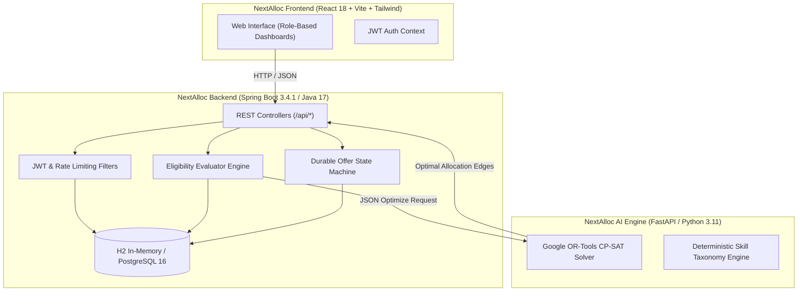

# NextAlloc — AI-Powered Smart Internship Allocation Engine

<p align="center">
  
</p>

<p align="center">
  <em>A transparent, global, constraint-satisfaction allocation engine with explainable AI for the PM Internship Scheme.</em>
</p>

<p align="center">
  
  
  
  
  
  
  
  
</p>

---

## 🚀 Overview

**NextAlloc** replaces traditional greedy, first-come-first-served, or single-applicant recommendation systems with a **global, population-wide multi-objective constrained optimization engine**. Powered by **Google OR-Tools CP-SAT**, NextAlloc evaluates all eligible candidates and opportunity capacities simultaneously to achieve mathematically optimal, fair, and explainable placements.

### Key Pillars

1. **Global Mathematical Optimization (OR-Tools CP-SAT):** Solves the entire candidate population at once rather than greedily filling seats one by one.
2. **Deterministic Pre-Optimization Eligibility Gates:** Enforces mandatory technical skills, minimum qualification thresholds, and institutional verification (NOC & academic standing) *before* candidate-opportunity edges enter the solver.
3. **Durable Offer Lifecycle & Concurrency Protection:** Atomic state machine (`OFFERED` $\to$ `ACCEPTED` $\to$ `JOINED` or `DECLINED`) protected by pessimistic row-level locking (`SELECT ... FOR UPDATE`), preventing oversubscription and active placement conflicts.
4. **Transparent Explainability:** Factor-by-factor attribution for every single match (Skills, Qualifications, Preferences, Location, Learning Potential, Experience) with human-readable narratives.
5. **Truthful Infeasibility Detection:** In impossible constraint configurations (e.g. demand exceeding capacity under full-coverage mandates), the solver truthfully reports `Infeasible allocation` with root-cause diagnostics instead of publishing hallucinated or invalid assignments.

---

## 🏛️ System Architecture



---

## ⚡ Quick Start

### Option 1: Docker Compose (Recommended)

Run the entire full-stack platform (FastAPI AI Engine + Spring Boot + Embedded React Frontend) with a single command:

```bash
docker compose up --build
```

- **Application URL:** [http://localhost:8080](http://localhost:8080)
- **Interactive Swagger UI:** [http://localhost:8080/swagger-ui.html](http://localhost:8080/swagger-ui.html)
- **AI Microservice Health:** [http://localhost:8000/health](http://localhost:8000/health)

---

### Option 2: Local Development

#### Prerequisites
- **Java 17+** (JDK) and **Maven 3.9+**
- **Python 3.10+** (with `pip`)
- **Node.js 18+** and `npm` (for frontend development)

#### 1. Start the AI Optimization Microservice
```bash
cd app/ai-service
python -m venv .venv
# Windows:
.venv\Scripts\activate
# Linux/macOS:
source .venv/bin/activate

pip install -r requirements.txt
uvicorn main:app --host 127.0.0.1 --port 8000
```

#### 2. Start the Backend & Built UI
In a new terminal:
```bash
cd app/backend
mvn spring-boot:run
```
The backend serves the built production frontend directly on [http://localhost:8080](http://localhost:8080).

#### 3. (Optional) Run Frontend in Vite Hot-Reload Mode
If developing UI components with live HMR:
```bash
cd app/frontend
npm install
npm run dev
```
Open [http://localhost:5173](http://localhost:5173). API requests are automatically proxied to the backend on `:8080`.

---

## 🛡️ Production & Security Configuration

NextAlloc is designed with production-grade security defaults:

- **JWT Authentication:** Stateful token validation with configurable signing secret (`NEXTALLOC_JWT_SECRET`) and 12-hour expiration window.
- **Login Rate Limiting:** In-memory bucket token rate limiter (`NEXTALLOC_RATE_LIMIT_LOGIN_PER_MINUTE`, default `8` req/min per IP) to prevent brute-force attacks.
- **Role-Based Access Control (RBAC):** Strict Spring Security URL boundaries (`/api/admin/**` restricted to `ROLE_ADMIN`, `/api/providers/**` to `ROLE_PROVIDER`, `/api/candidates/**` to `ROLE_CANDIDATE`).
- **Pessimistic Concurrency Control:** Row-level locks (`SELECT ... FOR UPDATE`) on opportunity seat capacities and candidate active placement counters prevent oversubscription even under high-concurrency race conditions.
- **CORS Hardening:** Configurable allowed origins (`NEXTALLOC_CORS_ORIGINS`, legacy fallback `PRAGATI_CORS_ORIGINS`).
- **Safe Information Disclosure:** Production error stack traces and internal class names are hidden (`server.error.include-stacktrace: never`).
- **Database Portability:** Runs zero-configuration H2 in-memory storage for demonstrations and native PostgreSQL 16 via environment variables (`SPRING_DATASOURCE_URL`, `SPRING_DATASOURCE_USERNAME`, `SPRING_DATASOURCE_PASSWORD`).

---

## 🧪 Verification & Testing

Run the automated test suites:

```bash
# Frontend contract & type checking:
npm --prefix app/frontend run typecheck
npm --prefix app/frontend run test

# Backend test suite (JUnit 5 & MockMvc):
mvn -f app/backend/pom.xml test

# Production Vite build:
npm --prefix app/frontend run build
```

---

## 📄 License & Attribution 
All demonstration records, AISHE codes, institution names, and candidate identities are synthetic.
